<p align="center">
  
</p>

<h2 align="center">
  
</h2>

<p align="center">
  
  
  
  
</p>

<p align="center">
  
</p>

<p align="center"></p>

## 🎞️ ACT I — THE ORIGIN STORY

> *A curious developer. A blinking cursor. A habit of turning "what if?" into `npm start`.*

I'm **Surya N**, a **Full Stack Developer** who lives in the MERN ecosystem and loves building web apps that feel fast, clean and purposeful. Lately the plot has thickened: I'm diving into **Generative AI, LLMs and RAG** to build apps that don't just *display* data, they *understand* it.

```javascript
const surya = {
  role: "Full Stack Developer",
  education: "B.Tech · Class of 2026",
  superpower: "MERN Stack",
  fuel: ["Curiosity", "Coffee", "Clean commits"],
  currentMission: "AI-powered products on top of solid full-stack foundations",
  status: "Open to opportunities 🚀",
  philosophy: "Build. Learn. Innovate."
};
```

<p align="center"></p>

## 🎭 ACT II — THE CAST

<p align="center">
  
</p>

<details>
<summary><b>🎥 Behind the camera — tools of the trade</b></summary>
<br/>
<p align="center">
  
</p>
</details>

<p align="center"></p>

## 🍿 ACT III — FEATURED PRODUCTIONS

### ⭐ Now Showing

<p align="center">
  <a href="https://github.com/Surya-1023/PDF_Reader(RAG)">
    
  </a>
</p>

<!-- Edit the text inside assets/spotlight.svg: project name, pitch, 3 features -->

### 🎬 The Filmography

<table>
<tr>
<td width="50%" valign="top">

#### 📄 RAG-Powered PDF Reader
**🎬 *Talk to your documents.***

Ask questions in plain English, get answers grounded in the PDF itself using Retrieval-Augmented Generation.

📑 Extraction · ✂️ Chunking · 🧬 Embeddings · 🔎 Vector search · 💬 Context-aware Q&A

`Python` `LangChain` `HuggingFace` `ChromaDB`

<a href="https://github.com/Surya-1023?tab=repositories"></a>

</td>
<td width="50%" valign="top">

#### 🎯 SRMS Event Management
**🎬 *From idea to registration in a few clicks.***

Smart event creation, registrations and college event administration in one place.

🗓️ Event management · 📝 Registration · 🔄 Workflows · 📱 Responsive UI

`TypeScript` `Next.js` `MongoDB`

<a href="https://github.com/Surya-1023/SRMS-event"></a>

</td>
</tr>
<tr>
<td width="50%" valign="top">

#### 📚 Learning Management System
**🎬 *Where students and educators meet.***

A web-based learning platform connecting students and educators through digital experiences.

`JavaScript` `Node.js`

<a href="https://github.com/Surya-1023/LMS-web"></a>

</td>
<td width="50%" valign="top">

#### 💼 Personal Portfolio
**🎬 *The director's showreel.***

A modern portfolio showcasing my skills, journey and projects.

`Next.js` `TypeScript` `Tailwind CSS`

<a href="https://surya-portfolio-main.vercel.app"></a>

</td>
</tr>
<tr>
<td colspan="2" valign="top">

#### 📦 Inventory Management System
**🎬 *Order out of chaos.*** CRUD operations and structured data management for organizing inventory.

`Web Development` `Database` `CRUD`

<a href="https://github.com/Surya-1023?tab=repositories"></a>

</td>
</tr>
</table>

<p align="center"></p>

## 🎬 ACT IV — COMING SOON

| 🎞️ Scene | 📖 What I'm exploring | 📈 Progress |
|---|---|---|
| **Agentic AI** | Agents that plan, use tools and act | `▰▰▱▱▱▱▱▱▱▱` |
| **Advanced RAG** | Better chunking, retrieval and re-ranking | `▰▰▰▰▱▱▱▱▱▱` |
| **LLM Applications** | Shipping real products on top of LLMs | `▰▰▰▱▱▱▱▱▱▱` |
| **TypeScript** | Type-safe full-stack apps | `▰▰▰▱▱▱▱▱▱▱` |

<p align="center"></p>

## 📊 BOX OFFICE

<p align="center">
  
  
</p>

<p align="center">
  
  
</p>

<p align="center">
  
</p>

<p align="center"></p>

## 🎯 THE PLOT TWIST

<p align="center">
  <b>Most developers build apps.</b><br/>
  <b>I'm building apps that think.</b><br/><br/>
  <i>Solid MERN foundations + Generative AI = products people actually want to use.</i>
</p>

<p align="center"></p>

## 📡 ACT V — LET'S MAKE THE SEQUEL

<p align="center">
  <a href="https://surya-portfolio-main.vercel.app"></a>
  <a href="https://www.linkedin.com/in/YOUR-LINKEDIN-USERNAME"></a>
  <a href="mailto:YOUR-EMAIL"></a>
</p>

<p align="center"><i>Open to opportunities, collaborations and building something meaningful.</i></p>

<h3 align="center">🎬 END CREDITS</h3>

<p align="center">
  Written in <b>JavaScript</b> · Directed by <b>Curiosity</b> · Powered by <b>Coffee ☕</b><br/>
  No bugs were harmed in the making of this profile (some were, sadly).<br/><br/>
  <i>"Great things are built one line of code at a time."</i><br/><br/>
  <b>Thanks for watching, and don't forget to ⭐ a repo on your way out!</b>
</p>

<p align="center">
  
</p>
